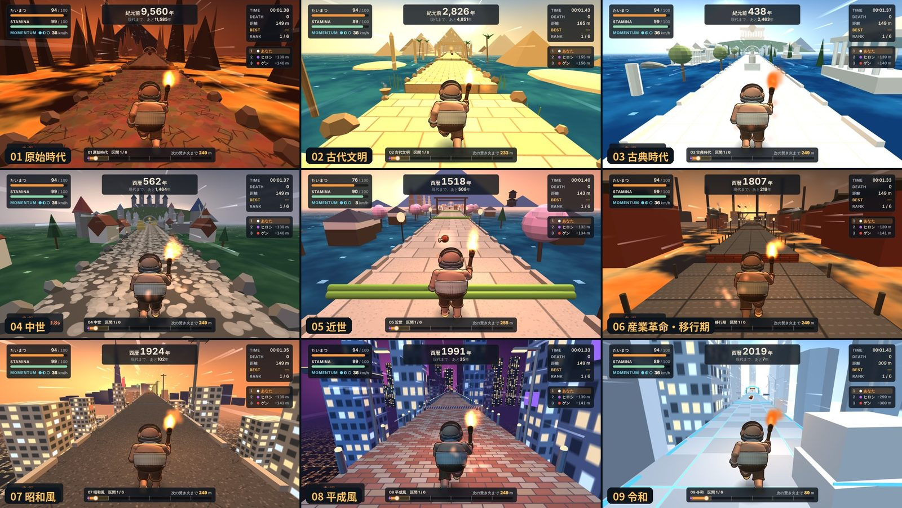
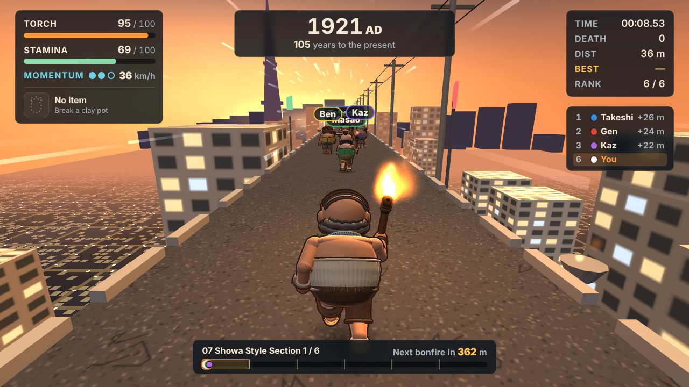
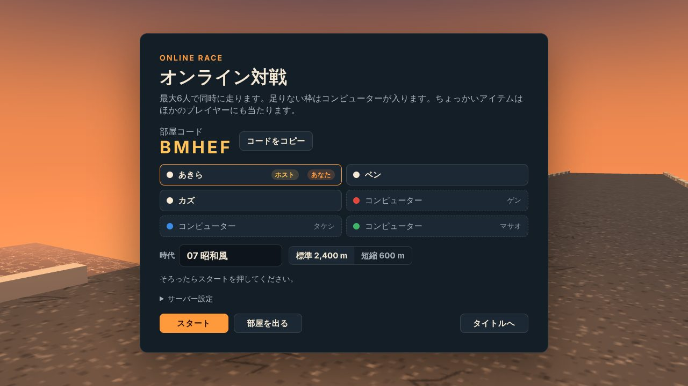

# 紀元前おじラン！ / Kigenzen Ojirun!

たいまつを掲げたおじさん6人が、紀元前1万年から令和まで9つの時代を駆けぬける、ボタンひとつのドタバタ3Dレースです。ブラウザだけで動き、オンラインで最大6人と対戦できます。

**▶ 遊ぶ：https://infoairen7.github.io/kigenzen-ojirun/**



## 特徴

- **9つの時代**：原始時代、古代文明、古典時代、中世、近世、産業革命・移行期、昭和風、平成風、令和。時代ごとに景色・障害物・落ちる先・BGM が変わります。
- **長押しで走る**：MOMENTUM が満タンになると時速40kmの全力疾走。手を離すと息が整い、スピードはしばらく続きます。
- **6人レース**：性格の違うコンピューターのライバル5人と競走。道の土器を割ると「ちょっかいアイテム」（骨ブーメラン・イガグリ・ほら貝）が手に入ります。
- **オンライン対戦**：最大6人が同時に走ります。クイック対戦か5文字の部屋コードで集まり、空き枠はコンピューターが入ります。サーバーの準備はいりません（ブラウザどうしで直接つながります）。
- **タイムアタック**：自分のベスト記録の「ゴースト」と競走。
- **絵も音もプログラム**：キャラクター・背景・BGM・効果音・声は、すべてコードで描画・合成しています（画像ファイルや録音素材はありません）。
- 日本語 / English、キーボード・コントローラー・タッチ（スマホは横向き）に対応。

| オンライン対戦 | 部屋 |
| --- | --- |
|  |  |

## 操作

| 操作 | キーボード | コントローラー | タッチ |
| --- | --- | --- | --- |
| 走る | SPACE 長押し | A 長押し | RUN 長押し |
| ジャンプ | SHIFT | B・RT | JUMP |
| アイテム | E・L | Y | アイテムボタン |
| 左右 / 減速 | A・D / S | スティック / LT | ◀ ▶ / 減速 |
| ポーズ | ESC | START | II |
| BGM オン／オフ | B | BACK | タイトル右上 |

連打で走りたい人は「設定 → 走り方 → 連打」。オンライン対戦中はポーズできません（ESC でレースから退出）。

## フォルダ

| 場所 | 中身 |
| --- | --- |
| `src/index.html` | ゲーム本体（3D・ルール・画面・オンライン対戦のクライアント） |
| `src/audio.js` | BGM・効果音・声の合成エンジン（Web Audio） |
| `vendor/` | three.js r128（MIT License） |
| `docs/` | GitHub Pages で公開しているビルド済みのゲーム |
| `server/` | 部屋の進行（ゲームにも組み込まれます）と、使いたい人向けの中継サーバー（Cloudflare Workers + Durable Objects）。[server/README.md](server/README.md) |
| `tools/` | ビルドとパッケージ作成、自動テスト |

## ビルド

Python 3 だけで組み立てられます。

```
bash tools/make.sh
```

- `dist/index.html`：1ファイルで動くゲーム（three.js は cdnjs から読み込み）
- `release/`：itch.io 用とオフライン用の zip（index.html と three.min.js）
- `docs/`：GitHub Pages 用のコピー

## オンライン対戦のしくみ

サーバーを用意しなくても、公開したページを開くだけで対戦できます。

- 部屋を作った人（クイック対戦では最初に来た人）のブラウザが、その部屋の進行役になります。ほかの人はそのブラウザへ WebRTC で直接つながり、位置やアイテムはその人を通して全員に届きます。
- おたがいを見つけるところだけ、[PeerJS](https://peerjs.com/) の無料公開サーバー（0.peerjs.com）を使います。部屋コード ABCDE は、そこでの名前 `kigenzen-ojirun-1-abcde` になります。
- 部屋を作った人がページを閉じると、その部屋はなくなります（走っている途中なら、残った人はコンピューター相手にそのまま走れます）。
- ブラウザどうしが直接つながるため、同じ部屋の人どうしにはおたがいの IP アドレスが伝わります（WebRTC のしくみです）。
- 会社や学校のネットワークなど、つながらない環境もあります。

自分で立てた中継サーバーを使うこともできます（`server/` を Cloudflare の無料プランに公開）。手順は [server/README.md](server/README.md) にあります。サーバーの URL はゲームの「サーバー設定」に入れるか、ビルド時に組み込みます。

```
TORCH_SERVER=https://kigenzen-ojirun-online.NAME.workers.dev bash tools/make.sh
```

## テスト

Node 22 以上、Python 3、Playwright（`pip install playwright && python -m playwright install chromium`）が必要です。`tools/make.sh` のあとに実行します。

```
bash tools/tests/run_tests.sh
```

ルール計算、全9時代のコースを完走できるか、画面の流れ、入力、BGM、画面サイズごとのレイアウト、3人同時のオンライン対戦（ブラウザどうし／中継サーバー、どちらもローカルで再現）、サーバー単体を確かめます。

## ライセンス

[MIT License](LICENSE)。同梱の three.js r128 も MIT License です（[vendor/three.LICENSE](vendor/three.LICENSE)）。

このゲームのコード（絵や音を生み出すコードを含む）とゲーム内の文章は、Anthropic の AI「Claude」と一緒に作りました。

---

## English

A silly one-button 3D race in the browser: six ojisan ("middle-aged guys") carry torches from 10,000 BC to the present day, through nine eras. Hold to run, fill MOMENTUM for a 40 km/h sprint, break clay pots for mischief items, and race up to six players online, with no server to set up.

**Play: https://infoairen7.github.io/kigenzen-ojirun/**

- Build: `bash tools/make.sh` (Python 3). Bake in an online server with `TORCH_SERVER=https://… bash tools/make.sh`.
- Online: browser to browser by default. The player who opens a room runs it in their browser (the same room code as `server/src/room-core.js`), the others connect over WebRTC, and the free public [PeerJS](https://peerjs.com/) broker (0.peerjs.com) introduces them. Players in a room can see each other's IP addresses, as with any WebRTC game. Optional relay server for Cloudflare Workers + Durable Objects: [server/README.md](server/README.md).
- Tests: `bash tools/tests/run_tests.sh` (Node 22+, Python 3, Playwright).
- Everything you see and hear is generated in code: no image files, no recordings.
- License: MIT. three.js r128: MIT. Made with the help of Claude, Anthropic's AI.
